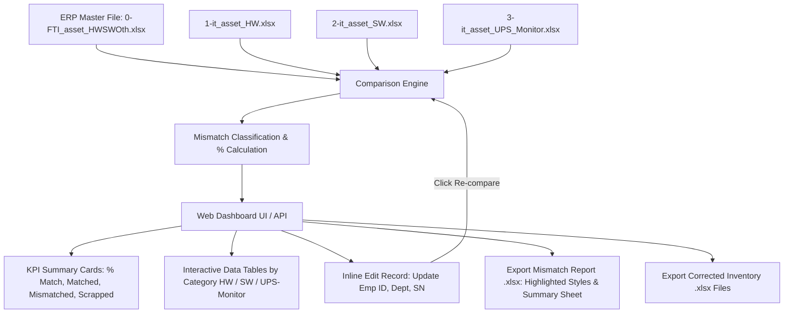

# แผนการพัฒนาระบบเปรียบเทียบข้อมูล FTI IT Asset Inventory และ Dashboard อัตโนมัติ

## 1. Goal Description
สร้างระบบเปรียบเทียบข้อมูลทรัพย์สินไอที (IT Asset) อัตโนมัติ ระหว่างไฟล์หลักจากระบบ ERP/AX (`0-FTI_asset_HWSWOth.xlsx`) กับไฟล์ข้อมูล IT Inventory ทั้ง 3 ประเภท:
1. `1-it_asset_HW.xlsx` (Hardware: PC, Notebook ฯลฯ)
2. `2-it_asset_SW.xlsx` (Software & Licenses)
3. `3-it_asset_UPS_Monitor.xlsx` (UPS และ Monitor)

ระบบจะประมวลผลคำนวณสถิติความตรงกัน (% Match Percentage), ระบุประเภทความไม่ตรงกัน (รหัสพนักงาน, แผนก, S/N, รายการตัดจำหน่าย, ข้อมูลที่ขาดหาย), ให้บริการ Web Dashboard พร้อมฟีเจอร์แก้ไขข้อมูลแบบ Inline (Data Correction), กดเปรียบเทียบใหม่ (Re-compare) ได้ทันที และส่งออกไฟล์รายงาน Excel ที่มีสีเน้น Mismatch ตามแบบฉบับ `HW_Mismatch_Report.xlsx` รวมถึงไฟล์ Inventory ที่แก้ไขแล้ว

---

## 2. Architecture & Design Decisions (สรุปจากการสัมภาษณ์)
- **Backend Architecture**: Python 3 (FastAPI + Uvicorn + Pandas + OpenPyXL)
- **Frontend Architecture**: Modern Glassmorphism Single-Page Dashboard (UI-UX Pro Max Standard, HSL Color Palette, Dark/Light Glow, Vanilla JS + CSS, No heavy node_modules build required, 100% offline-ready)
- **Department Normalization Engine**: Smart string & department code parsing (แยกเลขนำหน้าเช่น `1004/สารสนเทศ` เทียบกับ `สารสนเทศ` หรือ `ฝ่ายเทคโนโลยีและสารสนเทศ`)
- **Status & Scrapped Detection**: ตรวจจับสินทรัพย์ที่สถานะใน AX เป็น `Scrapped` หรือ `ตัดจำหน่าย`
- **Output & Export**:
  - สร้างไฟล์รายงาน Mismatch แยกตามประเภทสินทรัพย์และแท็บสรุป/แยกสี (รหัสพนักงาน=เหลือง, แผนก=ฟ้า, ทั้งคู่=แดง, ตัดจำหน่าย=เทา/ส้ม)
  - ดาวน์โหลดไฟล์ Inventory (.xlsx) ที่แก้ไขค่าแล้วกลับไปใช้งานจริง
- **Launcher**: ไฟล์ `start_app.bat` ดับเบิ้ลคลิกเดียว ติดตั้งไลบรารีที่จำเป็นและเปิดเบราว์เซอร์อัตโนมัติ

---

## 3. System Workflow (Mermaid Diagram)

---

## 4. Proposed Components & Changes

### Component 1: Comparison & Normalization Engine (`engine/comparator.py`)
- **Primary Key Matching**: `รหัสทรัพย์สิน` (IT) $\leftrightarrow$ `Fixed asset number` (ERP)
- **Field Mappings**:
  - รหัสพนักงาน: `รหัสพนักงาน` $\leftrightarrow$ `Responsible`
  - ชื่อผู้ถือครอง: `ผู้ใช้งาน/ดูแล` $\leftrightarrow$ `Name2`
  - แผนก/สถานที่: `สถานที่เก็บ` / `ฝ่ายงานตามผังบัญชี` $\leftrightarrow$ `Location`
  - หมายเลขเครื่อง: `S/N` $\leftrightarrow$ `Serial number`
  - ชื่อสินทรัพย์: `ชื่อทรัพย์สิน` $\leftrightarrow$ `Name`
- **Smart Normalization**:
  - ตัดช่องว่าง, แปลงตัวเลขเป็นสตริง (เช่น รหัสพนักงาน `6001728` vs `6001728.0`)
  - ตรวจจับคำว่า `สำนักงาน`, `ฝ่าย`, `แผนก` เพื่อจับคู่แผนกที่เทียบเคียงกันได้
  - เช็ค `Status == 'Scrapped'` หรือข้อความใน `Search name` ที่มี `จำหน่าย`
- **Classification Categories**:
  1. `รหัสพนักงาน + แผนกไม่ตรง`
  2. `รหัสพนักงานไม่ตรง`
  3. `แผนกไม่ตรง`
  4. `Serial Number ไม่ตรง`
  5. `ตัดจำหน่ายใน ERP แต่ IT ยังมีใช้งาน`
  6. `ไม่พบใน ERP (มีเฉพาะใน IT)`
  7. `ตรงกันสมบูรณ์ (Matched 100%)`

### Component 2: Styled Excel Generator (`engine/report_generator.py`)
- ใช้ OpenPyXL จำลองโครงสร้างเดียวกับ `HW_Mismatch_Report.xlsx`:
  - แผ่นงาน `สรุป`: ตาราง KPI ภาพรวม, สัดส่วน %, จำแนกตามประเภท, Color Legend
  - แผ่นงาน `ทั้งหมด`: รวมรายการ Mismatch ทุกประเภท พร้อมคอลัมน์ IT ข้างเคียงกับ AX
  - แผ่นงานแยกย่อย: `รหัสพนักงาน+แผนก`, `รหัสพนักงาน`, `แผนก`, `สถานะ/ตัดจำหน่าย`
  - การลงสีเซลล์:
    - พื้นหลังแดงอ่อน `#FFC7CE` / อักษรแดงเข้ม `#9C0006` สำหรับรหัสพนักงาน+แผนก
    - พื้นหลังเหลืองอ่อน `#FFEB9C` / อักษรน้ำตาล `#9C6500` สำหรับรหัสพนักงาน
    - พื้นหลังฟ้าอ่อน `#DDEBF7` / อักษรน้ำเงิน `#1F4E78` สำหรับแผนก
    - ขอบตารางแบบ Thin border และหัวคอลัมน์ตัวหนาพื้นหลัง `#1E293B` อักษรขาว

### Component 3: FastAPI Application & Endpoints (`app.py`)
- `POST /api/upload`: อัปโหลดไฟล์ Master และ Inventory (หรือโหลดไฟล์ตั้งต้นในโฟลเดอร์อัตโนมัติหากไม่ได้อัปโหลดใหม่)
- `GET /api/summary`: ดึงข้อมูลสถิติภาพรวม (% Match รวม, % แยกประเภท, จำนวนนับ)
- `GET /api/records`: ดึงรายการ Mismatch พร้อมฟิลเตอร์ค้นหา, จัดหน้า (Pagination), และเลือกหมวดหมู่
- `POST /api/correct`: บันทึกการแก้ไขข้อมูลของรายการนั้นๆ
- `POST /api/recompare`: ประมวลผลเปรียบเทียบซ้ำด้วยข้อมูลที่แก้ไขแล้วแบบ In-memory
- `GET /api/export/report`: ดาวน์โหลดไฟล์ Excel Mismatch Report
- `GET /api/export/inventory/{type}`: ดาวน์โหลดไฟล์ Inventory Excel ที่แก้ไขแล้ว
- Static files mounting: เสิร์ฟหน้า Web UI

### Component 4: Premium Web Dashboard UI (`static/index.html`, `static/style.css`, `static/app.js`)
- มาตรฐาน **UI-UX Pro Max**:
  - Dark Slate & Glassmorphism Theme พร้อม Neon Cyan / Emerald Accent
  - Hero Header แสดงสถานะการเชื่อมต่อและปุ่มอัปโหลด/เริ่มวิเคราะห์
  - Circular Progress Gauge แสดง % Match Rate แบบมี Animation
  - Tab Switcher: ภาพรวม (Overview) | Hardware | Software | UPS & Monitor
  - Interactive Filter & Search Bar ค้นหาด่วนตามรหัสทรัพย์สิน, ชื่อพนักงาน หรือแผนก
  - Inline Edit Modal / Table Action สำหรับเจ้าหน้าที่ IT แก้ไขค่าได้ทันที
  - ปุ่ม 1-Click "Re-compare" และ "Export Excel"

### Component 5: Launcher & Helper Scripts (`start_app.bat`, `run.py`)
- ตรวจสอบและติดตั้ง `requirements.txt` (`fastapi`, `uvicorn`, `openpyxl`, `pandas`, `python-multipart`)
- เริ่มรัน Uvicorn server ที่ `http://127.0.0.1:8000`
- เปิดเว็บบราวเซอร์อัตโนมัติ (Default Browser)

---

## 5. Verification Plan

### Automated Verification:
1. รันสคริปต์ทดสอบเปรียบเทียบไฟล์จริง:
   - ตรวจสอบว่าระบบสามารถอ่านไฟล์ `0-FTI_asset_HWSWOth.xlsx`, `1-it_asset_HW.xlsx`, `2-it_asset_SW.xlsx`, `3-it_asset_UPS_Monitor.xlsx` ได้ครบถ้วน
   - ตรวจสอบผลลัพธ์ Mismatch ของฝั่ง Hardware ว่าสอดคล้องกับรายงานอ้างอิง `HW_Mismatch_Report.xlsx` (177 รายการ Mismatch พื้นฐาน)
   - ตรวจสอบการสร้างไฟล์รายงาน Excel ผลลัพธ์ว่าเปิดได้ถูกต้องและสไตล์สีตรงตามข้อกำหนด
2. รัน Integration Test ของ API:
   - ทดสอบจำลองการแก้ไขข้อมูล (`/api/correct`)
   - ทดสอบการกด Re-compare (`/api/recompare`) ว่าค่า Match % เพิ่มขึ้นถูกต้อง

### Manual Verification via Browser:
1. รัน `start_app.bat` และเข้าสู่ Dashboard ที่ `http://127.0.0.1:8000`
2. ทดสอบการดูข้อมูล Mismatch ในแต่ละแท็บ (HW, SW, UPS/Monitor)
3. ทดลองแก้ไขข้อมูล 1-2 รายการ แล้วกดปุ่ม "เปรียบเทียบใหม่ (Re-compare)" ตรวจสอบการอัปเดตของกราฟและตาราง
4. กดดาวน์โหลดไฟล์รายงาน Excel และเปิดดูความถูกต้องของการไฮไลท์สี
